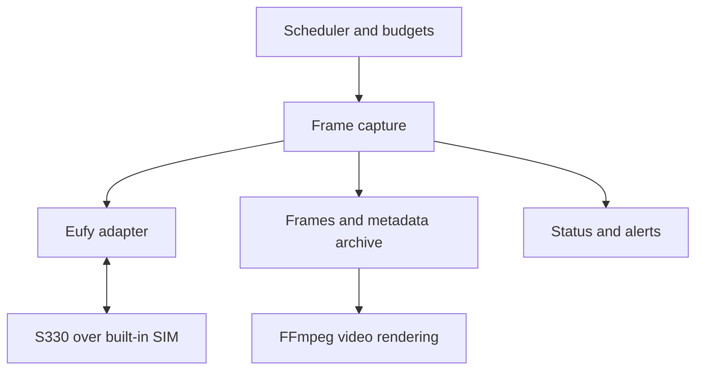

# Eufy S330 Construction Time-Lapse Service — Technical Specification

**Version:** 1.1\
**Date:** October 31, 2026\
**Status:** Native LTE feasibility shown on the actual camera, at 98% of first tries in a back-to-back run (section 3.1). Battery behavior on solar is not yet measured. The capture service runs on the target host. The offsite archiver and monthly preview are not built.

**Changes in 1.1**, from running the real camera and from the owner's decisions:

- The adapter is `@mega-yfue/eufy-sdk` with this project's own connect on top; the legacy library failed on this account, and the SDK's connect wasn't reliable (sections 2, 3.1).
- The minimum frame size is **3840×2160**, and renders exclude smaller frames by default (sections 3, 8).
- The target cadence is **every 5 minutes**, thinned by battery tiers, with more frames kept than any one render uses (section 6.1).
- The session budget default rises to **6,000 seconds per day** to fit that cadence (section 6.3).
- Eufy credentials are Docker secret files, because the credential gateway can't carry them (section 10).
- Activity-based rendering and bonus frames are recorded as post-MVP ideas (section 14).

The service will document approximately one year of construction using an already-purchased **eufy 4G LTE Cam S330 (T86P2)** connected through its **built-in SIM card** and powered by a battery and solar panel. It will capture fresh frames on a schedule, archive them off-camera, and render videos for selected date ranges.

**Phase 1 is a native-LTE feasibility test on the actual camera.** A successful login, device discovery, or retrieval of a motion-event thumbnail is not sufficient to proceed with the full service.

# 1. Goals and Scope

## Required outcomes

- Capture a new frame without someone manually opening the Eufy app.
- Store frames with observed timestamps, image properties, and verifiable provenance.
- Release the camera connection after each capture and bound failed attempts.
- Recover from service restarts, temporary LTE outages, and unavailable archive storage.
- Surface missing frames and notify the owner when manual intervention is necessary.
- Build MP4 time-lapse videos entirely from stored frames, without reconnecting to the camera.

The MVP serves **one owner, one camera, one construction site, and one continuously running host**. The host may be a home Linux server, Raspberry Pi, or VPS, provided access to the actual camera is verified **from that host**. No computer is required at the construction site.

Out of scope for the MVP: a web dashboard, multi-user or multi-camera support, continuous recording, construction activity recognition, automatic frame stabilization, synthesis of missing frames, and automatic camera firmware updates. Configuration and a CLI provide control; the CLI and a private HTTP endpoint expose service status.

# 2. Connectivity Evidence and SDK Selection

| Evidence | Implementation consequence |
| --- | --- |
| T86P2 does not officially support NAS, and HomeBase connectivity for this camera uses Wi-Fi. A built-in scheduled time-lapse mode and a public interval-capture API have not been established in the reviewed official material. [S1] | Use a third-party implementation of the Eufy protocol. |
| `eufy-security-client` can handle this device family and remote P2P connections, but the repository is archived. [S2] | Use it as the first candidate for an experimental adapter; validate behavior on the actual camera. |
| A report involving two T86P2 cameras describes successful remote video access with the legacy library. Those cameras were connected by Wi-Fi to an LTE router. [S3] | This does **not** prove access over the camera's built-in SIM. |
| A report covering three T86P2 units on mobile networks describes frequent live-stream connection failures through the newer bridge, plus an isolated successful capture. [S4] | Native LTE must be demonstrated; it is not an assumed capability. |
| The relay-fallback fix for the new SDK has merged. [S5] | Validated on this camera over its built-in SIM: every 4K frame so far came through the relay (section 3.1). |
| `eufy-security-client` returned an empty device list for this account, and its maintainer describes the API it uses as one Eufy is shutting down. | The legacy adapter is removed; it failed the probe's first step. |
| The SDK and HTTP bridge may return retained imagery if a live request fails. [S6, S7] | Verify frame provenance explicitly; never silently substitute a cached frame. |

**Adapter selection:** `@mega-yfue/eufy-sdk`, pinned at exactly `0.5.0`, after the legacy option failed. Supporting both adapters simultaneously is not an MVP requirement. This project already replaces the SDK's connect behavior (section 3.1). If the SDK's data path later breaks too, the next step is taking the rest of the verified protocol into this project's own client, not going back to the legacy library.

Before installation, inspect available releases, select an exact version, and pin it in the lockfile. Version `4.2.0` in [S3] is the version reported by that user, **not** a dependency already verified for this project. Pin a fork by commit SHA. Avoid floating `latest` tags and unpinned branches.

# 3. Native-LTE Feasibility Probe

## Test conditions

Use the owner's camera with an active built-in SIM. Confirm cellular connectivity in the Eufy app or through available telemetry. The capture host must be on a different network. The Eufy app must not need to keep a live view open during the test.

Implement a `timelapse probe` CLI command that runs **three independent captures, 15 minutes apart**. After each attempt, release the stream, decoder, and camera connection. The authenticated account session may persist across attempts.

For each attempt, record:

- Camera model and firmware; adapter and exact dependency version.
- Confirmed connection type, and cellular operator when provided by the owner or device telemetry.
- Request start time, first live-media time, and frame-save time.
- Actual resolution, codec, and method used to establish freshness.
- Camera session duration, available traffic counters, and connection-cleanup result.
- Battery percentage and age of the reading, if available.

Minimum acceptable image size: **3840×2160**, by the owner's decision: the camera delivers it, and a smaller frame would pull a whole render down to its size. This is a project acceptance threshold, not a manufacturer guarantee. The accessible resolution was measured, not inferred from the camera's 4K marketing designation.

## Probe acceptance criteria

All three attempts must retrieve frames from **new live sessions**, meet the minimum resolution, and successfully release resources. Subsequent connections must work after idle periods without someone manually waking the camera in the app.

Where practical, verify freshness with a controlled change in the scene between attempts. Equal or different file hashes alone do not prove that an image is fresh.

If the probe fails, its deliverable is a diagnostic report identifying the failure and the next bounded experiment (for example, a connectivity setting or alternate adapter). Continuous operation remains **blocked**. Returning the latest thumbnail is not an acceptable workaround or a passing result.

## 3.1 Findings on the actual camera

Measured on a T86P2 (firmware 1.2.4.4) on cable power, on its built-in SIM, from the production host, on the night of October 31, 2026.

**What works:**

- The SDK reaches the camera over the built-in SIM and receives real **3840×2160** H.265 keyframes.
- The camera sits behind symmetric carrier NAT, so every 4K frame has come through the **relay**. A direct path won occasionally in early tests, stayed at 720p and carried little data.
- Each stream starts at 1280×720 for the first keyframe and steps up to 3840×2160 from the next, about 2 seconds later. The service holds the session until it has two keyframes at the required size, then stops. One FFmpeg run decodes each keyframe, because a single FFmpeg output locks to the first frame's size.
- A capture takes about **13 seconds** of camera contact when the camera has to wake, and about **0.5 MB** of media, which is about 1.8 GB per month at the target cadence. That counts media bytes only; compare it with the carrier's figure.

**The connect is this project's, not the SDK's.** The SDK's own connect was unreliable on this camera, so `src/adapters/p2p-policy.ts` changes it by wrapping private methods of the pinned SDK, tested against the real class. `lab/hammer.ts` fires captures back to back and traces the packets:

| Connect | Tries | 4K | Camera never joined | Hang-ups or no video | Median session |
| --- | --- | --- | --- | --- | --- |
| SDK's own | 13 | 23% | 7 | 5 | 33 s |
| One socket, relay after 7 s, no lookups once on the relay | 24 | 71% | 7 | 1 | 17 s |
| Also: no hole punch, and ask again on a stall | 40 | 98% | 0 | 3 | 17 s |
| Also: relay from about 2 s, and one stream start | 100 | 98% | 0 | 2 | 9.4 s |

The first two rows were rotated together, the last two ran as their own blocks. What each change does:

- **Asking again.** The SDK asks the lookup servers for the relay list once. A try that stalled stayed stalled until the SDK's 45-second timeout, though the relay answered within a second whenever it answered at all. Asking again after 2 seconds took "camera never joined" from 7 of 24 to 0 of 140, with stalled tries recovering in the same session. A relay doesn't answer a bare hello from an unregistered socket, which fits relays depending on what the lookup servers have arranged, but the mechanism on the camera's side is inferred, not observed.
- **One stream start.** The SDK started a running stream a second time once the level-2 key arrived, and the camera often closed the session right after acknowledging it. Hang-ups 3 to 3.6 seconds in went from about 4 in 100 tries to none in 100. 4K arrives without that second start.
- **Asking for the relay early.** The lookup servers hold the list until the camera is ready, so waiting first added only time.
- **Hole punching.** Carrier NAT defeats it. Removing it removed traffic, with no measured harm.

Answering the camera's relay packets, and switching to another relay on a stall without asking for the list again, were tried and did nothing.

**What's left:** about 2% of tries. A session closes about 2 seconds in with no visible cause, or the camera never completes the key exchange and closes at about 6 seconds. Neither has a root cause. The next try, 5 seconds later, handles both, at a cost of under 10 seconds.

**At the real pace:** the first 6 slots at 5 minutes were all 4K on the first try. A longer run is in progress.

**Not ruled out:** what the camera does on its side is only visible through the relay. Battery cost has not been measured, because the camera has only run on cable. It's the main open question for the 5-minute target.

# 4. Architecture

Proposed stack: **TypeScript, Node.js, FFmpeg, SQLite, Docker Compose, and S3-compatible object storage**. Select the Node.js runtime based on the installed SDK's requirements; the newer SDK currently requires at least Node.js 24.5.0. [S9]



A single process owns the Eufy session and performs camera captures sequentially. SQLite tracks scheduled slots, capture attempts, and upload state. Frames are written locally first and uploaded independently to object storage. Rendering runs in a separate process and must not block scheduled captures.

The scheduler, archiver, and renderer must not depend on concrete SDK classes. Define an internal adapter contract for authentication, camera discovery, acquisition from a new live session, and connection teardown. These are **service-level responsibilities**, not claims that the underlying SDK exposes methods with those exact names.

Automatic SDK failover on error is out of scope. Changing adapters requires a new native-LTE validation and must be recorded in subsequent frame metadata.

# 5. Capture Requirements

## 5.1 What counts as a fresh frame

An accepted frame must be decoded from the video data of a **new live session started for that capture attempt**. Prohibited sources include notification images, cloud previews, retained-snapshot fallback, JPEG files previously saved on disk, and any media buffer from an earlier session.

This proves the acquisition path, not the exact physical exposure time if the camera provides no trustworthy frame timestamp. Record reception time and camera exposure time separately; set unknown exposure times to `null`.

Start a new live stream and decoder per attempt, and register event handlers before sending the start command.

Disable the SDK's retained-image cache with `storedSnapshotCache: false`, reject any `retained: true` result, and prevent reuse of frames from an earlier shared stream. Calling `snapshotLive()` without those safeguards is insufficient. Likewise, do not treat bridge endpoint `/snapshot/<sn>?mode=live` as a guaranteed fresh source. [S6, S7]

On a cold start, wait for keyframes at the required size. The observed policy: hold the session until two keyframes at the minimum size have arrived or the attempt's deadline passes, then use the last keyframe at the highest resolution. A fixed delay alone is not proof of freshness, and a fixed window lost 4K on a slow path.

## 5.2 Capture attempt lifecycle

1. Acquire the exclusive camera lock; check the schedule, authentication state, and budgets.
2. Create a capture-attempt record with a unique identifier.
3. If configured and experimentally supported, restore the selected camera framing/preset.
4. Open a new live session, obtain a frame, and validate its image data and provenance.
5. Atomically store a versioned record of the attempt beside the received stream, so those bytes survive a crash.
6. In `finally`, stop the live stream, decoder, and camera connection.
7. Decode the frame, then atomically publish it with its final metadata, including the cleanup outcome; complete the attempt record and enqueue archive upload.

Decoding comes after teardown so that FFmpeg never keeps the camera awake, which matters on every frame of a solar-powered session. A crash between steps 5 and 7 therefore leaves bytes that aren't a frame yet. Reconciliation decodes them and publishes the frame with `cleanup_status=unknown_after_crash`. If they won't decode, the slot counts as missed.

The frame-acquisition timeout is **30 seconds per attempt**, twice the slowest 4K session measured. Allow up to **10 additional seconds** for cleanup. The SDK may impose tighter internal timeouts; extending the service-level timeout does not automatically change them.

Release the connection immediately after success. The newer SDK's default five-minute idle disconnect is unsuitable for a standalone battery camera if it continues heartbeats beyond capture. Use explicit teardown or a verified short idle interval, such as up to five seconds. Disable event-driven pre-warming. [S8]

Track **capture success** and **cleanup success** separately. If the frame is already saved, a cleanup error must not trigger a second capture for that slot. Record the cleanup fault, restart a stuck worker if necessary, and alert the owner.

Handle SIGTERM by shutting down the active capture and releasing resources. SIGKILL, host crashes, and network loss cannot guarantee delivery of a stop command: bound the local connection lifetime and verify the camera's behavior when the client disappears during the pilot.

## 5.3 Framing and image quality

The default installation uses a fixed camera position and one field of view; the owner disables auto-tracking during setup. Verify that the camera retains its orientation after sleep and reboot.

Preset restoration is optional and may be enabled only after the exact camera has been tested for support. Apply a configurable settling delay after movement. The service must not silently modify security/surveillance settings.

Store each extracted frame at its **actual resolution** without crop, overlay, or rescaling. "Original frame" means an image decoded/extracted from the video stream, **not** a sensor RAW photograph. If a frame falls below the quality threshold, preserve the real frame as `degraded`, report the problem, and do not count it as meeting target quality.

If the same camera is used for security, account for the documented T86P2 behavior: event recording pauses during Live View. [S10]

# 6. Scheduling and Resource Limits

## 6.1 Initial schedule

The target schedule is **one capture every 5 minutes, every day from 08:00 through 17:55** (the `18:00` endpoint is exclusive), for **120 scheduled frames per day**, thinned by battery so a weak day costs frames rather than the camera:

| Battery | Capture every |
| --- | --- |
| 60% or more | 5 minutes |
| 40% or more | 15 minutes |
| Below 40%, or unknown | 60 minutes |

The tiers select from one fixed slot grid, so frames stay evenly placed when the cadence changes. They are starting values, to be set from measured battery behavior on solar. If the measurements don't support 5 minutes, the top tier moves rather than the design.

At 365 days with no missing frames, this produces 43,800 images, or about **24 minutes at 30 fps** if all of them were used. That is deliberately more than a final video needs: more frames at capture, and the choice of which to use at render. Both project duration and frequency are configurable.

Calculate schedules in the construction site's **IANA time zone**. The sample configuration uses `America/Chicago`; confirm the actual site's time zone at deployment. Store all timestamps in UTC and display local times with their UTC offset. The host's time zone must not alter scheduling.

For daylight saving time changes, mark nonexistent local instants as skipped with a reason; execute duplicated local instants once, on their first occurrence. A daytime schedule normally avoids these hours, but the rules must remain correct if the schedule changes.

## 6.2 Retries and restart recovery

Uniquely identify a scheduled slot by `(project_id, camera_id, scheduled_at_utc)`. Accept **at most one frame per slot**. Manual snapshots use separate IDs and do not improve scheduled-capture completeness.

Allow **three attempts total** per slot, **5 seconds** apart: a failed try now costs seconds, and a long wait only keeps the camera awake for longer. The overall slot deadline is **180 seconds after its scheduled time**. Do not start an attempt unless enough time remains for both acquisition and cleanup limits. Retry only transient connectivity or media-acquisition errors.

Authentication failures, unsupported protocols, invalid image provenance, and insufficient disk space must not enter a retry loop. After a restart, the service may resume only a still-valid slot. Mark expired past slots as missed; never take a burst of present-day photos to impersonate missing historical captures.

Permit only one active capture at a time. Manual capture and `probe` must use the same lock. The MVP runs **exactly one capture-service instance per Eufy account profile**.

## 6.3 Battery and LTE data usage

Initial project thresholds:

- Warn when charge falls below **35%**.
- Pause capture at **25% or lower**.
- Resume at **40% or higher**.

These are configurable service thresholds, not manufacturer limits. The MVP must not secretly alter its capture frequency: it warns, pauses, or changes tier only by configured rules, and reports the active interval in its status.

Use battery readings available without waking the camera. Treat readings older than **six hours** as stale. Show an unknown battery value as unknown, never as zero. When capture remains permitted without recent telemetry, keep the time budgets active and issue a warning. Do not automatically clear a battery pause without a fresh sufficient reading. A failed read says nothing about the battery, so it leaves the last reading in force for choosing a rate until that reading goes stale, and reads that keep failing raise their own alert. A slot skipped because the battery is unknown records `battery_unknown`, not `battery_tier`, so the status never blames the battery for an outage.

While paused for low battery, continue receiving passive updates. If battery status updates only when the camera is contacted, notify the owner to check the charge in the Eufy app and run `resume --battery-checked`. Log this explicit manual override; it does not turn an old reading into a fresh one. Periodically waking the camera just to check the battery is not required in the MVP.

The additional budget defaults to **6,000 seconds of camera-contact time per day**, generous against the roughly 1,600 seconds that 120 slots at about 13 seconds each would use. Set it from measured use. Count all attempts from the first camera-facing command through teardown, including failed attempts. This is a conservative software counter—not a measurement of actual awake time or energy consumption. Reserve time before starting an attempt; always allow cleanup commands even if the budget is exhausted.

Configure the **monthly data budget** after selecting the SIM plan and measuring a pilot. **JPEG file size is not LTE traffic consumption.** Track media-stream bytes and available network-byte counters separately, along with each measurement's coverage. If the library cannot observe the entire transport, label totals as estimates and compare them with the SIM provider's statistics.

With a configured data budget, warn at 80% and stop new capture attempts at 100% according to the chosen measurement. This does not govern Eufy-app traffic, background camera communication, or other consumers of the SIM plan. Do not promise exact carrier-plan enforcement from an incomplete counter. Before traffic calibration, the camera-contact time budget is the main pilot safeguard.

Persist counters, budget reservations, and attempt counts in SQLite; a restart must not reset them. For an interrupted attempt with an uncertain outcome, conservatively charge the full reserved amount. A budget day starts at `00:00` in the site's time zone; an attempt is assigned to the date on which it starts. The MVP monthly budget uses the calendar month in that zone. If the SIM carrier bills on a different cycle, expose the mismatch in budget configuration.

# 7. Storage and Data Model

## 7.1 Capture storage and offsite archive

Keep SQLite and the local image spool on durable storage in a persistent Docker volume. Write JPEG and JSON metadata into a temporary directory, then atomically rename the complete directory. Enforce a unique database constraint on the scheduled slot. After crashes, reconcile completed local directories against DB rows without recapturing an already saved slot. Mark unfinished cleanup as `unknown_after_crash`, not as successfully completed.

Reconciling adopts a stored frame only if its metadata, its place in the spool and its bytes all agree, and it belongs to the configured project and camera. A scheduled frame must also hold its own slot: the writer only leaves one unrecorded by dying while that slot is `running`, so a slot row in any other state, or from another schedule revision, refuses it. A frame with no slot row at all is still adopted and its row rebuilt from its metadata, because that's what a lost database looks like, those frames are what a render needs, and the camera must never go after a slot that already has a frame. A refused frame is left in place and raises an alert.

Adopting a frame, with its slot, is one transaction. A frame row whose slot row is gone gets it rebuilt the same way, if the stored frame still matches. A frame row whose slot doesn't name it back is finished only in the shape a crash leaves: a `running` slot naming no capture, and a stored frame that still matches its row. Any other disagreement is left as it is and raises an alert. Each start also checks every stored frame against its row in the background, because reading a year of frames takes minutes and capture doesn't wait for it. A frame that no longer matches is left in place, raises an alert, and is left out of renders. So is one whose recorded location isn't the one derived from its own project, camera, date and id, or whose files are links leading elsewhere.

An independent worker uploads artifacts to S3-compatible storage. Example object layout:

```text
project/camera/2026/10/21/<capture_id>/frame.jpg
project/camera/2026/10/21/<capture_id>/metadata.json
```

Upload the image first; the final capture metadata JSON is the **commit marker**. That JSON becomes immutable after upload. Store upload status and completion time separately in SQLite and exported manifests. Never overwrite an unrelated object under an existing capture identifier.

Verify remote persistence using a checksum supported by the provider or by reading the object back and comparing SHA-256. **Do not assume an S3 ETag is a universal SHA-256 checksum.** Once archival is verified, local copies may be deleted according to retention policy; the suggested local retention is seven days.

If archive storage is unavailable, continue local spooling while enough disk space remains. Never automatically discard unarchived frames. Pause camera capture and alert the owner if free disk space reaches the configured minimum. An upload failure must not wake the camera or cause an image to be recaptured.

Retain source frames throughout the project and until the owner explicitly approves deletion. A completed MP4 does **not** replace the original-frame archive. Bucket versioning is recommended; all data and access settings remain private. Perform consistent backups of SQLite; the core capture metadata must also be recoverable from archived JSON files.

## 7.2 Per-frame metadata

Required field groups:

| Group | Fields |
| --- | --- |
| Identity | `capture_id`, `project_id`, `camera_id`, `slot_id`, `attempt_id`, `schedule_revision` |
| Time | `scheduled_at_utc`, `request_started_at`, `stream_started_at`, `frame_received_at`, `camera_captured_at`, `site_time_zone` |
| Provenance | `source=live_p2p`, `capture_session_id`, `freshness_basis`, `retained=false`, `adapter`, `adapter_version`, `camera_firmware` |
| Image | `width`, `height`, `source_codec`, `jpeg_bytes`, `sha256`, `quality_status` |
| Operation | `attempt_count`, `connect_ms`, `session_ms`, `cleanup_status`, `battery_percent`, `battery_observed_at` |
| Data usage | Available byte counters, `traffic_measurement_basis` |
| Archive state in SQLite/exported manifest | `object_key`, `archive_status`, `archived_at`; these mutable fields do **not** belong in the immutable capture JSON |

Unknown observations must be represented as `null` with an explanation, not fabricated values. Do not copy `frame_received_at` into `camera_captured_at`. Do not present an old battery reading as though it were observed at capture time. Use the internal `camera_id`, rather than the full device serial number, in ordinary application logs.

Slot states: `pending`, `running`, `captured`, `captured_degraded`, `missed`, `skipped_policy`. Unsuccessful slots require a `reason`, such as `auth_required`, `camera_unreachable`, `capture_timeout`, `decode_failed`, `stale_source`, `battery_low`, `session_budget`, `data_budget`, `storage_full`, or `operator_paused`. Track archive status independently of capture status.

# 8. Video Rendering

The CLI command `timelapse render --from YYYY-MM-DD --to YYYY-MM-DD` selects frames using the site's local calendar dates, sorts by actual receive time, and preserves their scheduled-slot associations. Include scheduled frames by default; manual captures may be opted in explicitly.

Output defaults: **MP4, H.264, 30 fps, no audio, original aspect ratio**. Resize only derived render inputs; never modify source images. Do not upscale by default. Choose a consistent output size no larger than the smallest selected frame. Do not crop construction progress simply to fill the canvas. Date overlays and alternative frame rates are render options.

By default, **compress gaps**: the next available frame follows the previous frame immediately. The source archive and manifest continue to identify missing slots. Do not insert synthetic imagery disguised as real captures.

For every render, save an input-frame manifest, transformation parameters, FFmpeg version, and exclusion list. **Exclude `degraded` frames by default and list each one in the exclusion list**: since the output is no larger than the smallest selected frame, one 720p frame would downscale a whole 4K video. `--include-degraded` opts them in, with an explicit warning in the render report.

Acceptance: the MP4 plays, frames are in chronological order, and video duration is `number of included frames / fps` within container rounding tolerance. A render failure must never stop scheduled capture. The only scheduled render task in the MVP is a **monthly preview**; the full final video is generated on demand.

# 9. Control and Observability

The service CLI must expose `login`, `probe`, `capture`, `run`, `status`, `pause`, `resume`, `render`, and `export-manifest`. These are commands to be implemented by this service. Commands accessing the camera share the same account profile, camera lock, and resource budgets.

`status --json` and the private `/status` endpoint expose: most recent successful capture and its age, next scheduled slot, completeness, consecutive errors, active pause reason, battery reading and its age, budget counters, upload backlog, and available disk space.

Capture completeness for a period equals **scheduled slots with accepted frames / configured scheduled slots**. Show slots omitted due to battery, budgets, authorization, or owner action separately; do not silently remove them from the denominator. Also report the share of slots meeting the minimum quality threshold. Manual captures never affect these metrics.

`/healthz` reports **process liveness only**. Account authentication, camera reachability, and archive health must have separate statuses. An HTTP 200 from the service does not mean frames are being captured successfully.

Send notifications through a single configurable webhook for:

- Three consecutive scheduled slots without a captured frame.
- Required 2FA, CAPTCHA, or other manual authentication step.
- A pause due to battery, budget, or disk space; failure to terminate a camera connection.
- The oldest unarchived frame waiting more than six hours, or local disk space approaching exhaustion.
- Recovery from one of the above conditions.

Send one notification when an issue begins, at most one reminder per day, and one recovery notification. A failed notification delivery must not trigger additional camera captures. Do not include photos or credentials in notifications by default. The owner configures the destination before continuous operation begins.

# 10. Authentication and Deployment

Persist the Eufy authentication session across process restarts. Do **not** initiate a full login every 15 or 60 minutes. Prefer a separate account with shared access to the camera if the chosen SDK supports shared-device access; verify this during Phase 1.

A token lasts 30 days, so a run this long replaces one about every month, and that must not take a person. The SDK logs in again when Eufy rejects the token. If that fails, the adapter asks the login directly, because the SDK's error doesn't say why: only a challenge or a refusal stops captures. An outage during the login, or a second rejection inside the SDK's hold-off, is a failed try that the next try repairs.

If authentication requires 2FA or CAPTCHA, pause new camera operations and expose the specific manual step needed. Do not retry logins indefinitely. Supply credentials via Docker secret files or protected environment variables; never write them to the repository, logs, manifests, or HTTP responses. Session files must be readable only by the service account.

A credential gateway such as OneCLI can't hold the Eufy login: the password is ECDH-encrypted into the request body, v6 bodies are encrypted and signed, the camera traffic is UDP, and a gateway writes only headers, query, and path. Credentials sent in a plain header, such as a webhook's, can use the gateway.

Deploy as one Docker Compose project with persistent volumes and a restart policy. FFmpeg must decode the camera's **actual** H.264/H.265 stream. Bind HTTP to loopback by default; use an existing secure tunnel or an authenticated reverse proxy for remote access.

Do not require a public inbound IP address or port forwarding on the camera's cellular connection. Verify outbound P2P/relay connectivity from the **target server**. A successful test on a home computer is not sufficient evidence that a later VPS deployment will work.

After a change in SDK version, camera firmware, SIM operator, or capture host, repeat a short cold-connection probe. Do not automatically roll untested dependency updates into the running service.

# 11. Sample Configuration

These are proposed MVP defaults, not camera capabilities guaranteed by Eufy. The owner supplies the project dates, actual site time zone, camera serial, SIM tariff, archive destination, and webhook during setup. Missing deployment-specific values must not prevent local development using a mock adapter.

```yaml
project:
  id: construction
  site_time_zone: America/Chicago
  start_date: null
  end_date: null

camera:
  id: site-overview
  model: T86P2
  serial_file: /run/secrets/eufy_camera_serial
  adapter: mega
  framing: fixed
  min_width: 3840
  min_height: 2160

schedule:
  grid_minutes: 5
  window_start: "08:00"
  window_end_exclusive: "18:00"
  days: [mon, tue, wed, thu, fri, sat, sun]

cadence:
  tiers:
    - { battery_at_least: 60, every_minutes: 5 }
    - { battery_at_least: 40, every_minutes: 15 }
    - { battery_at_least: 0, every_minutes: 60 }
  unknown_battery_every_minutes: 60

capture:
  acquisition_timeout_seconds: 30
  cleanup_timeout_seconds: 10
  target_keyframes: 2
  max_attempts: 3
  retry_delay_seconds: 5
  slot_deadline_seconds: 180
  max_session_seconds_per_day: 6000

battery:
  warn_below_percent: 35
  pause_at_or_below_percent: 25
  resume_at_or_above_percent: 40
  reading_max_age_hours: 6

traffic:
  monthly_budget_mb: null
  warn_fraction: 0.8
  pause_fraction: 1.0
  measurement_basis: uncalibrated

storage:
  local_root: /data
  keep_archived_local_days: 7
  min_free_disk_mb: 1024
  s3_bucket: null
  s3_prefix: construction

render:
  fps: 30
  codec: h264
  include_manual: false
  include_degraded: false
  upscale: false
  missing_frames: skip

alerts:
  webhook_url_file: null
  consecutive_failed_slots: 3
  upload_backlog_hours: 6
  reminder_hours: 24

http:
  bind: 127.0.0.1
  port: 8787
```

# 12. Delivery Plan and Acceptance

## Phase 1 — Compatibility verification

**Deliverables:** probe CLI, selected adapter, three real images acquired through the built-in SIM, and a diagnostic report. Verify independent live sessions, actual resolution, connection release, and repeated cold starts. Mock tests cannot substitute for real-device results. If compatibility fails, do not proceed with the continuous-capture implementation until that specific limitation has been resolved.

## Phase 2 — Capture service and archive

**Deliverables:** Compose deployment, configuration, scheduler, SQLite state, local image spool, S3 archiver, resource budgets, status reporting, and alerts. Support manual capture and manifest export. One accepted frame corresponds to one scheduled slot; missing historical slots remain missing.

## Phase 3 — Seven-day pilot and rendering

Run **seven complete days on the intended production host** with the cadence chosen from calibration. The acceptance threshold is **at least 98.5% of scheduled slots with genuinely fresh frames** (69 of 70 at the original hourly schedule), received before their respective deadlines and at or above the configured minimum resolution. Slots the battery tiers leave out don't count against it, but are reported separately. No retained thumbnails may be accepted, no duplicate slots may exist, and no camera connection may remain unintentionally open.

Preserve and separately count `degraded` frames; they **do not** satisfy the quality acceptance threshold. Each missed slot must have a recorded explanation. Measure battery behavior, actual cellular data usage, and notification delivery during the pilot.

By the end of the pilot, all captured source frames must be present in a verified offsite archive, and a video rendered from them must play correctly. Choose the sustained capture interval and limits based on observations. A seven-day pilot determines an initial operating mode; it does **not** prove that the solar panel can maintain the camera throughout all seasons. Ongoing monitoring and configurable limits are required for year-long operation.

## Required failure tests

| Scenario | Expected behavior |
| --- | --- |
| SDK returns a retained image or old file | Reject it; do not mark the scheduled slot as captured. |
| Scene remains unchanged | Identical hashes alone do not invalidate a verified live frame. |
| Camera connectivity is lost | Enforce deadlines/retry counts; continue scheduling future slots. |
| Video cannot be decoded or FFmpeg hangs | Enforce timeout and cleanup; never substitute a thumbnail. |
| Process terminates during capture | No unbounded local resource hold; reconcile state on restart. |
| Process terminates after saving a frame or during upload | Do not recapture the saved slot; resume upload idempotently. |
| Offsite archive becomes unavailable | Retain local frames, retry upload; never delete unarchived data. |
| Local disk space runs low | Stop new camera attempts before losing previously captured data. |
| Battery or resource budget crosses its threshold | Record and report pause reason; bound further camera activity. |
| Authentication requires human intervention | Pause captures; avoid login loops or false positive captures. |
| Host time zone differs, or DST transition occurs | Follow site-local schedule without duplicated slots. |
| Rendering process fails | Keep archive and scheduled capture operational. |

Use a mock adapter and small local video fixtures for repeatable failure testing. Verify observable behavior and data durability; tests need not imitate the SDK's internal implementation.

## Delivery package

Provide a service repository containing a README, Dockerfile, Docker Compose configuration, secret-free sample configuration, pinned dependencies, DB migrations, CLI, adapter, archiver, renderer, and critical failure tests. Include operating instructions for first-time authentication, auth recovery, migration to a new host, and exporting every original image.

Before enabling year-long operation, fill in project dates, site time zone, Eufy credentials, offsite storage, and notification destination. Validate built-in SIM connectivity, framing, image quality, and observed budgets. Capture frequency, minimum acceptable resolution, and budget values remain runtime configuration—not code changes.

# 13. Not Built Yet

- The S3 offsite archiver. Frames are spooled on the host, whose storage is durable, but there is no offsite copy; the destination is not chosen.
- The monthly preview render.
- A notification destination. Alerts go to the service log until a webhook is configured.
- Battery and solar calibration, which needs the camera on its panel.

# 14. Post-MVP Ideas

Recorded so they aren't lost; neither is in the MVP.

- **Activity-based rendering:** use more frames when there is visible work and fewer when nothing happens, chosen at render time by comparing stored frames. It needs no camera contact and costs no battery, which is why capture keeps more frames than a render uses.
- **Bonus frames:** capture extra frames when the camera's own motion events suggest activity, if the battery can afford it.

# 15. References

External capability and limitation information was reviewed on **October 21, 2026**. Architecture, thresholds, and acceptance criteria above are **proposed MVP design decisions**, not verified Eufy product guarantees.

- **S1** [Eufy 4G LTE Cam S330 (T86P2), official product information and FAQ](https://www.eufy.com/products/t86p2121).
- **S2** [Legacy `eufy-security-client` repository](https://github.com/bropat/eufy-security-client).
- **S3** [T86P2 remote-network report and library comparison](https://github.com/mega-yfue/eufy-sdk/issues/300).
- **S4** [Three T86P2 cameras on cellular networks: connection failures and isolated success](https://github.com/mega-yfue/ha-eufy-sdk-addon/issues/47).
- **S5** [Proposed relay fallback fix](https://github.com/mega-yfue/eufy-sdk/pull/474).
- **S6** [New SDK implementation of retained-frame fallback](https://github.com/mega-yfue/eufy-sdk/blob/main/src/client/eufy-mega.ts).
- **S7** [Bridge snapshot endpoint behavior](https://github.com/mega-yfue/ha-eufy-sdk-bridge/blob/main/docs/ws-protocol.md).
- **S8** [SDK connection lifecycle and battery behavior](https://mega-yfue.github.io/connectivity).
- **S9** [New SDK repository and runtime requirements](https://github.com/mega-yfue/eufy-sdk).
- **S10** [Eufy: event-recording limitation during Live View](https://service.eufy.com/article-description/Troubleshooting-Guide-for-Motion-Detection-of-4G-LTE-Cam-S330).
